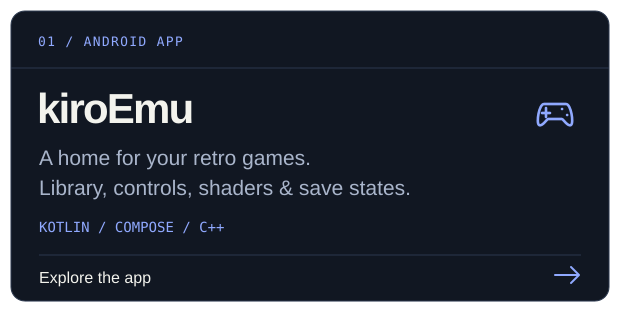
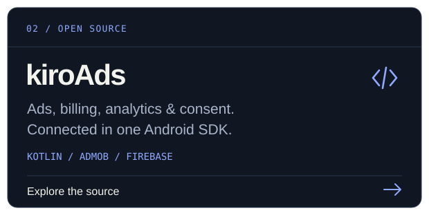

<!-- Custom, repository-owned SVG layouts. Rebuild with tools/generate_assets.py. -->
<p align="center">
  <a href="https://kirozxy.dev">
    <picture>
      <source media="(max-width: 600px)" srcset="./assets/profile-header-mobile.svg" />
      
    </picture>
  </a>
</p>

<p align="center">
  <a href="https://kirozxy.dev"></a>
  <a href="https://play.google.com/store/apps/details?id=com.kirozxy.emulator"></a>
  <a href="mailto:contact@kirozxy.dev"></a>
  <a href="https://ko-fi.com/kirozxy"></a>
</p>

### Behind the code

I'm **Kiro**, a junior Android developer from **Vietnam**. I build apps, work with native code, and make time for retro games.

- **In the editor:** Kotlin, Jetpack Compose, and C/C++ through the Android NDK.
- **On my desk:** [kiroEmu](https://kirozxy.dev/kiroemu.html) and [kiroAds](https://github.com/kirozxy/kiroAds).
- **After hours:** games, anime, and a lofi playlist. [Want to play something?](https://kirozxy.dev/#arcade)

### Currently building

<p align="center">
  <a href="https://kirozxy.dev/kiroemu.html"></a>
  <a href="https://github.com/kirozxy/kiroAds"></a>
</p>

<p align="center">
  <a href="https://play.google.com/store/apps/details?id=com.kirozxy.emulator">Google Play</a>
  &nbsp; · &nbsp;
  <a href="https://kirozxy.dev/kiroemu.html#changelog">Release notes</a>
  &nbsp; · &nbsp;
  <a href="https://github.com/kirozxy/kiroAds">kiroAds source</a>
</p>

### My toolbox

<p align="center">
  
</p>

<p align="center">Jetpack Compose · Android NDK / JNI · Coroutines &amp; Flow</p>

<details>
<summary>Architecture, libraries &amp; workflow</summary>

- **Architecture:** MVVM, MVI, Hilt / Dagger.
- **Async:** Coroutines, StateFlow, SharedFlow.
- **Storage & networking:** Room, Retrofit.
- **Firebase:** Authentication, Cloud Firestore, Cloud Messaging.
- **Workflow:** Git, Gradle, GitHub Actions, Figma.

</details>

### On GitHub

<p align="center">
  
  
</p>

<details>
<summary>Contribution streak</summary>

<br />
<p align="center">
  
</p>

</details>

<details>
<summary>A little more about me</summary>

I like readable, testable code, learning more about Android, and sharing ideas through teamwork and code reviews. Outside development: cats and foxes, football, and a good book.

```kotlin
object Kiro {
    val name = "Kiro"
    val role = "Junior Android Developer"
    val born = 2002
    val nationality = "Vietnamese"
    val pronouns = listOf("he", "him")

    val interests = listOf(
        "Retro games", "Anime", "Lofi music",
        "Cats & foxes", "Football", "Books"
    )
}
```

Personal email: [hanhatminh366@gmail.com](mailto:hanhatminh366@gmail.com).

</details>

### Let's connect

[Email](mailto:contact@kirozxy.dev) &nbsp; / &nbsp; [Facebook](https://facebook.com/kirozxy/) &nbsp; / &nbsp; [Instagram](https://instagram.com/kiro.zxy) &nbsp; / &nbsp; [Steam](https://steamcommunity.com/id/kirozxy/)

<p align="center"></p>
